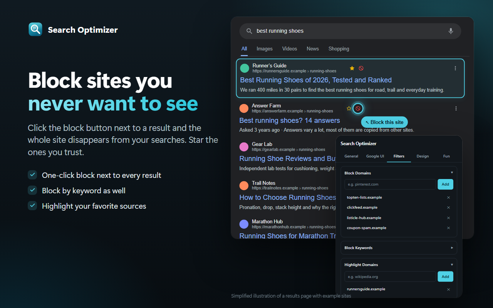
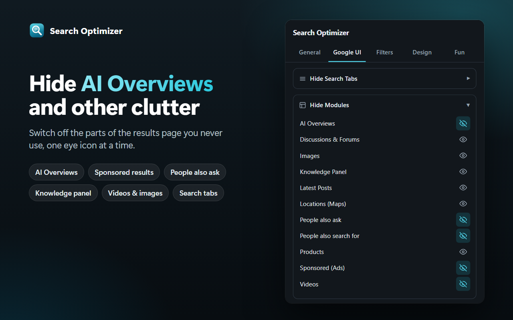
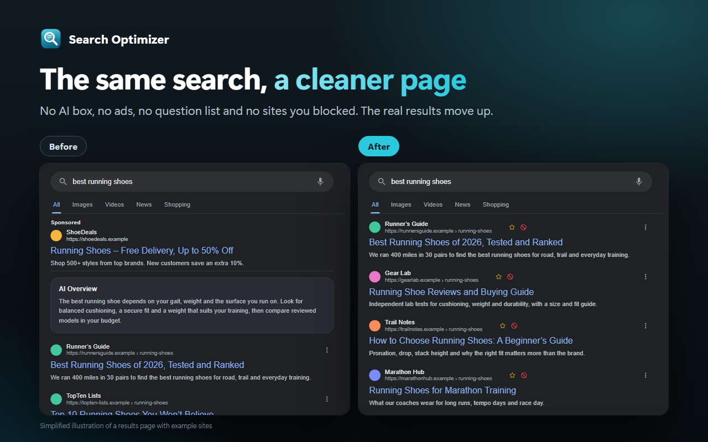
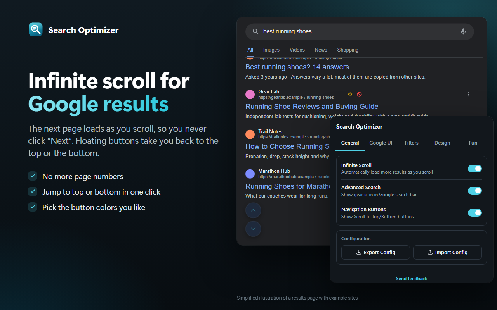
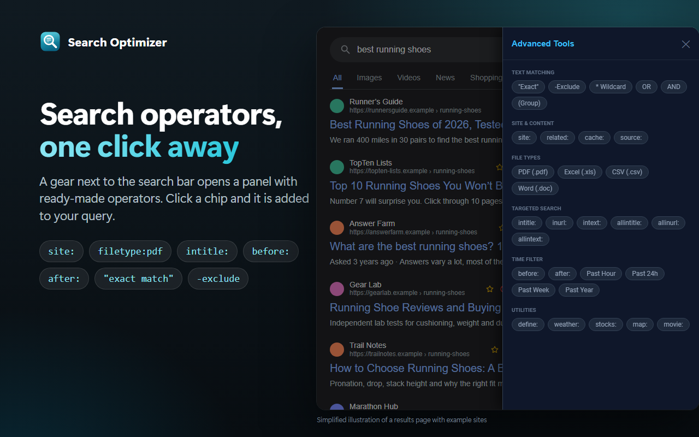

<h1 align="center">Search Filter & Site Blocker</h1>

<b>Take back your Google Search: block sites, hide AI Overviews, ads and clutter, and scroll results endlessly. Also known as Search Optimizer. No account, no tracking.</b>

  
  
  
  
  

## Features

- **Block sites**: click the block button next to any result, or add a domain in the popup. Results from that site disappear from every search.
- **Block keywords**: add words or phrases and every result that contains one disappears. Matching is by whole word and ignores upper and lower case.
- **Highlight sites you trust**: click the star next to a result, or add domains and keywords. Matching results get a colored frame.
- **Hide AI Overviews**: switch off the AI box on the results page.
- **Hide clutter**: sponsored results, People also ask, People also search for, the knowledge panel, discussions and forums, locations, products, videos and image blocks.
- **Tidy navigation**: hide search tabs you never use, such as More, Tools, Books, Finance, Flights, Maps, News, Shopping or Videos.
- **Infinite scroll**: the next page of results loads while you scroll. A switch turns it off at any time.
- **Scroll buttons**: floating buttons jump to the top or the bottom of the page.
- **Search operators**: a panel next to the search bar with ready-made operators (`site:`, `filetype:`, `intitle:`, `inurl:`, exact match, exclude, `OR`, `before:`, `after:`) and quick filters for the past hour, day, week and year.
- **Image tools**: in expanded Google Images results, open the image, download it or copy its link.
- **Your colors and a backup**: theme presets or your own colors; export all settings as JSON and import them on another computer.

It works on Google Search results pages: google.com, .de, .at, .ch, .co.uk, .fr, .es, .it, .nl and .be.

| | |
|---|---|
|  |  |
|  |  |

## Install

- **Chrome, Brave and other Chromium browsers:** [Chrome Web Store](https://chromewebstore.google.com/detail/dbmhbnmbodpdkhhifkpckaafanchciej)
- **Microsoft Edge:** [Edge Add-ons](https://microsoftedge.microsoft.com/addons/detail/search-filter-site-bloc/plonjcofdcfonocbhjlgljniadkidnig)
- **From source:** see [Development](#development).

## Getting started

1. Install the extension and run a Google search.
2. Click the toolbar icon. In **General**, switch on Infinite Scroll. Under **Google UI**, hide what you do not need.
3. Click the block button next to a result, or add a domain or a keyword under **Filters**.
4. Click the gear next to the search bar to open the search operators.

## Permissions and privacy

Your lists and settings are stored in your browser and never leave your device. Infinite scroll loads the next results page straight from Google, exactly like clicking "Next". Read the [privacy policy](PRIVACY_POLICY.md).

| Permission | Why it is needed |
|---|---|
| Access to the Google Search domains above | the filters, buttons and panels run on results pages |
| `storage` | save your lists and settings |
| `tabs` | refresh your open Google Search tabs when you change a setting |
| `webNavigation` | apply the AI Overview option before a results page loads |
| `downloads` | save an image when you click Download in image results |

## Support

- Questions, bugs or ideas: [open an issue](https://github.com/exUs541/Search-Optimizer/issues).
- More about Search Filter & Site Blocker and the other extensions: [exus541.github.io/portfolio](https://exus541.github.io/portfolio/index.html), with a [feedback form](https://exus541.github.io/portfolio/feedback.html).

## Development

The extension runs straight from this folder, there is no build step.

1. Clone the repository.
2. Open `chrome://extensions` (or `edge://extensions`) and switch on **Developer mode**.
3. Choose **Load unpacked** and select the repository folder.

| Path | Purpose |
|---|---|
| `manifest.json` | extension manifest (Manifest V3) |
| `background.js` | service worker |
| `content_scripts/` | `link_filter.js` (filters and highlights), `operators_panel.js` (search operators), `image_tools.js` (image results) |
| `popup.html`, `popup.js`, `popup.css` | settings popup |
| `icons/` | extension icons |
| `store-assets/` | store texts, screenshots, logo sources and their generator, see its [README](store-assets/README.md) |
| `.github/` | release pipeline, see [RELEASING.md](.github/RELEASING.md) |

Google is a trademark of Google LLC. This extension is an independent project and is not affiliated with, endorsed by or sponsored by Google.

## License

Released under the [MIT License](LICENSE).
